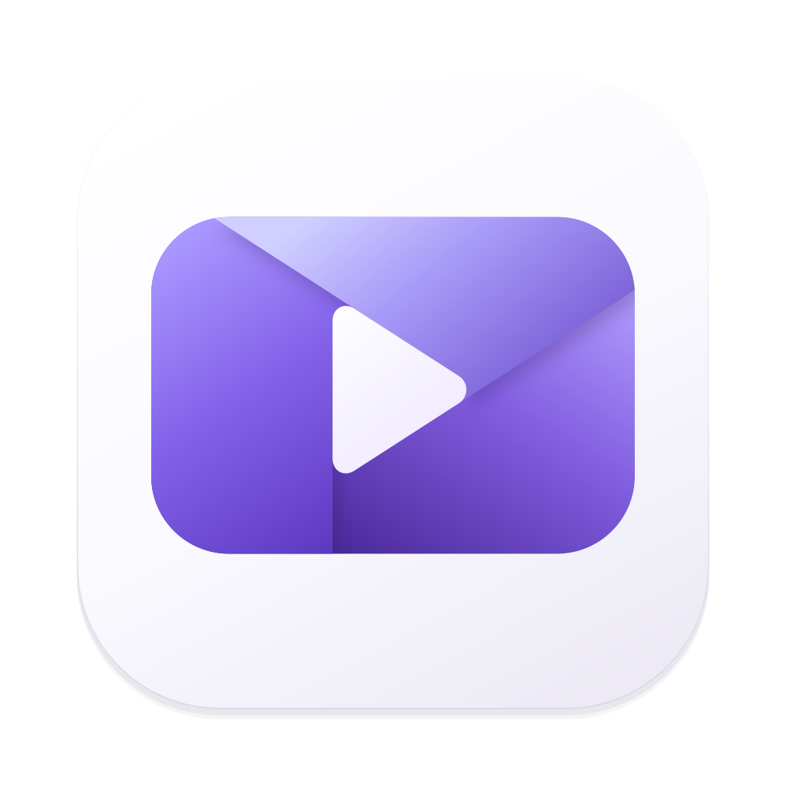
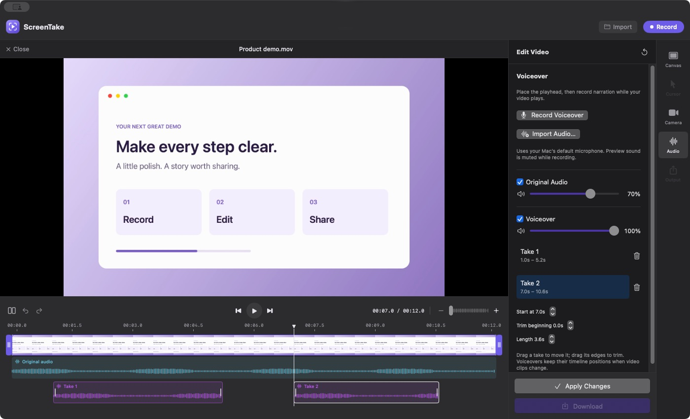
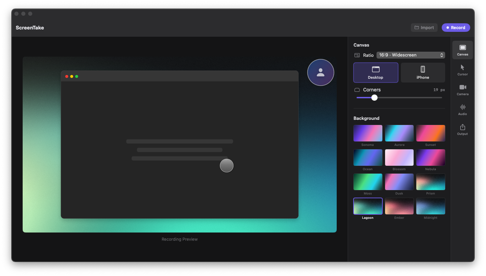

# ScreenTake



ScreenTake is a native screen recorder and editor for Mac. Record your screen, then shape the video with cursor effects, smart zoom, backgrounds, a webcam overlay, and voiceover narration.

**Latest release: 0.1.20 (build 22)** · Apple Silicon (M1 or newer) · macOS 13 Ventura or later

[Visit the website](https://sso-ss.github.io/ScreenTake/) · [Download the DMG](https://sso-ss.github.io/ScreenTake/downloads/ScreenTake-0.1.20-build22.dmg) · [Release notes](https://sso-ss.github.io/ScreenTake/release-notes.html)

## New in 0.1.20

- Add styled text overlays and edit video, camera, audio, zoom, and text on their own timeline tracks.
- Remove the camera background with the new **Background Removed** overlay type. Preview it live and use it in exported video.
- Adjust recorded audio separately from its video and choose whether gaps close after cuts. Silence cleanup also works with added audio tracks.
- Control these editing features from a connected AI client. The updated MCP helper ships inside the app; reconnect the client after updating ScreenTake.

## Included from 0.1.19

- Upload your own background image, replace or remove it, and keep it inside saved projects. The same image appears in previews, recordings, and exports.
- Choose among 16 wallpapers in a four-column grid of square thumbnails. New 4K Silk, Pastel, Breeze, and Mint backgrounds share soft, translucent folds in four palettes.
- Draw, move, and resize manual zoom regions, including on imported videos and phone layouts.
- Adjust phone corner rounding separately and use floating phone chrome around your content.

## Included from 0.1.18

- Finish trimmed-recording audio processing without encoding the video a second time when audio levels are unchanged. This avoids the stalled processing path and preserves rendered video quality.
- Show the processing stage after audio merging completes, so later work no longer stays labeled “Merging audio”.
- Delete the selected timeline strip immediately, use smoother drag previews, and choose persisted zoom transition motion.

## Included from 0.1.17

- Clear obsolete and intermediate files from imported-video exports to reduce temporary disk use. Original media, the current result, Undo references, and saved projects are preserved.
- Keep generated frames evenly spaced during long exports with many zooms, including imported videos with sparse frame timing.
- Validated a 15-minute imported video with 300 zooms and audio at 1080p. The exact user-reported failure could not be confirmed without the original clip or error message.

## Included from 0.1.16

- Download and install updates inside ScreenTake using Sparkle. Automatic update checks show a menu bar badge; manual checks open the installer flow.
- Open **Settings → Updates** to enable **Automatically download and install updates on quit**. This option is off by default. Future updates download in the background and install when you quit.
- Recording, media processing, and unsaved projects block quitting or restarting for an update. Save an editable project before installing. If a restart is deferred, finish your work and choose **Install and Relaunch** in Updates settings.
- Update feeds and downloads are signed and verified before installation.

Install 0.1.16 or later from the DMG once to enable the new updater. Builds through 0.1.15 still require a manual installation.

## Included from 0.1.15

- Export more reliably when the video encoder is busy. Failed or cancelled exports preserve an existing destination file, and export failures are logged for troubleshooting.
- Edit with shortcuts for playback, frame stepping, splitting, undo/redo, audio linking, timeline zoom, applying changes, and export. Open the timeline's **keyboard** button for the shortcut reference.
- Choose **Mirror Camera** in the Camera panel before recording or while editing. Mirroring applies consistently to the live camera preview, editor preview, and exported video, and is retained in saved projects. Existing projects keep their original orientation.

## Included from 0.1.14

- Open the editor sooner after stopping a recording. Video effects render when you apply changes or download your finished video.
- Retain native screen detail, including odd-sized window captures, and avoid scaling original-size content at 1×.
- Keep the timeline ruler and playhead synchronized with playback, seeking, and timestamps.
- Save editable projects, work with separate recorded audio clips, and use browser-content cropping.
- Choose an app language independently of recording settings.
- Connect AI clients to the local editor to inspect, edit, save, and export an open project.
- Use optional camera beauty and makeup filters with face tracking and faster live previews.
- Find ScreenTake in the menu bar and see an update badge until the available update is installed.
- Keep the three-panel purple logo and the camera, audio, and framing controls from earlier releases.

## Camera and audio improvements from 0.1.12

- Switch camera sections between **Overlay** and **Full Screen**, adjust full-screen zoom and framing, and optionally follow one face.
- Use the main **Split** button to give camera sections their own layout. Splitting a screen recording also splits its camera presentation.
- Add optional smooth camera transitions with adjustable duration and motion.
- Preview your camera directly in the recording canvas. Enabling the camera turns on the microphone; you can still turn it off or use the microphone on its own.
- Choose a microphone above **Record Voiceover**, using the same saved device selection as the recording controls.
- Preserve source resolution through screen exports and use higher-quality camera capture for full-screen layouts.

## New backgrounds


Four palettes with the same soft silk folds. Choose a preset or upload your own image in the Canvas panel.

## See the app

### Edit and add your voice



The native editor in 0.1.10, shown with sample footage and narration. Record a voiceover while the video plays, then move or trim each take on its own audio strip.

### Set up a recording



Choose your canvas, background, cursor, camera, and audio settings before recording. The workspace above shows the recording preview with placeholder content.

## What you can do

| Area | Features in the Mac app |
| --- | --- |
| Screen capture | Choose a display or window; record at 30 or 60 FPS; pause, resume, and stop from the native capture toolbar or keyboard shortcuts. |
| Recording audio | Capture microphone audio, system audio, or both. Choose an available microphone. Camera and microphone controls remain independent; enabling the camera turns the microphone on by default. |
| Voiceover | Choose a microphone and record narration while watching your video, starting at the playhead, or import an audio file. Move, trim, and remove individual takes. View original audio and narration waveforms. Adjust volume and mute separately for original audio and the voiceover group. |
| Timeline editing | Import a video or edit a new recording. Trim, split, remove sections, and drag clips to reorder them. Add styled text overlays. Use separate video, camera, audio, zoom, and text tracks and editing shortcuts for playback, frame stepping, split, undo/redo, audio linking, and timeline zoom. |
| Pause cleanup | Detect pauses in original or added audio, preview the suggestions, and choose which to remove. Undo restores removed sections. |
| Cursor and clicks | Show or hide the recorded cursor; choose Arrow, Hand, or Circle; adjust its size from 50–300%; enable click highlighting and choose its color. |
| Zoom | Use automatic click zoom or toggle manual zoom during recording. Add, move, trim, and remove zoom sections in the editor. Draw a manual focus region, then move or resize it, including on imported videos and phone layouts. Under Cursor → Zoom → Zoom transition, choose Smooth, Linear, Ease In, or Ease Out for preview and export. |
| Camera and overlays | Preview your camera in the recording canvas; record or import camera footage. Optionally mirror the camera in previews and export. Choose Circle, Rounded Square, or Background Removed overlays, or Full Screen per section. Adjust size, position, zoom, and framing, optionally follow one face, and add smooth transitions with adjustable duration and motion. |
| Canvas and framing | Choose Original, 16:9, 16:10, 1:1, 4:5, or 9:16. Use desktop or phone framing, adjust desktop and phone corners separately, use floating phone chrome, and crop phone content with Fit or Fill. |
| Backgrounds | Choose 16 built-in wallpapers, including 4K Silk, Pastel, Breeze, and Mint, in a four-column grid of square thumbnails. Upload, replace, or remove your own image; saved projects embed it. Toggle the background for an original-size desktop canvas. |
| Preview and export | Preview edits immediately after recording; render effects when applying changes or exporting a MOV. Save a .screentake project to retain source media and edits. Recordings and editable source files stay on your Mac. |

Select your microphone above **Record Voiceover** in the Audio panel. The selection is shared with the recording controls. **Default** follows your Mac’s default input. Preview sound is muted while recording. Takes keep their timeline positions when video clips change, so check narration alignment after rearranging your video.

## Install

1. Download the DMG on an Apple Silicon Mac.
2. If updating, save your work and quit ScreenTake first.
3. Open the DMG and drag **ScreenTake.app** into **Applications**.
4. Open ScreenTake and allow Screen Recording, Microphone, and Camera access when needed.
5. Make a short test recording and check the exported video and audio before sharing.

Use **File → Save Project…** to retain source media, capture data, and edits in a `.screentake` project. Use **File → Export Video…** or the **Download** control to export a finished MOV; pending edits render before the file is saved.

This build is signed with a Developer ID certificate and notarized by Apple. If macOS blocks the first launch, confirm you downloaded the current DMG and report the exact message. Do not disable macOS security protections.

## Connect an AI client

Open **ScreenTake → AI Connection…** and choose **Copy Setup** to get the MCP command for the app you are running. The signed app includes `screentake-mcp`; a compatible client connects to it as a local stdio server with no arguments. Keep ScreenTake open with a video or project loaded. After updating ScreenTake, restart the client’s MCP connection to load the new tools. See [AI editor setup](docs/ai-native-editor.md#connect-an-ai-client-mcp) for configuration examples.

## Keyboard shortcuts

These editing shortcuts are available in 0.1.15 and later. Click the timeline's **keyboard** button to see them in the app.

### Editing and files

| Shortcut | Action |
| --- | --- |
| Space | Play or pause the editor preview. |
| J / K / L | Play in reverse / pause / play forward. |
| Left / Right Arrow | Step backward or forward one frame with the timeline focused. |
| Shift + Left / Right Arrow | Seek backward or forward one second with the timeline focused. |
| Command + Left / Right Arrow | Go to the start or end of the edited video. |
| Home / End | Go to the start or end of the edited video. |
| Command + B | Split the selected track at the playhead, or the screen track when no track is selected. |
| Command + Z | Undo the last edit. |
| Command + Shift + Z | Redo the last edit. |
| Delete | Remove the selected clip, camera take, voiceover, or zoom section with the timeline focused. |
| Command + Shift + L | Link or unlink the selected recorded audio/video section. |
| Command + = / Command + - | Zoom the timeline in or out. |
| Command + Shift + Return | Apply pending changes. |
| Command + E / Command + S | Open the Save dialog to export the finished video. |
| Command + Shift + S | Save an editable `.screentake` project. |
| Command + O | Open a video for editing. |
| Command + Shift + O | Open an editable project. |

Playback keys work while the editor is active and yield to text fields and dialogs. Click a timeline clip to focus the timeline for frame stepping, one-second seeks, and deletion. Editing actions are unavailable while recording or processing media.

### During recording

| Shortcut | Action |
| --- | --- |
| Control + Z | Toggle manual zoom during recording. |
| Control + Space | Pause or resume recording. |
| Escape | Stop recording. |

The recording shortcuts work across apps. During recording, plain Z and Space also toggle zoom and pause when the capture toolbar has keyboard focus. Control + Space can conflict with macOS input-language switching; use the capture toolbar if needed.

## Current limitations and updates

- Smart zoom and recording reliability are still being refined. Some devices may experience microphone stalls or a brief black frame at the start of the webcam overlay. Check the exported result.
- Saved `.screentake` projects retain source media and capture data for later editing. Imported finished videos do not include original cursor capture data, but support manually placed zoom regions.
- Editable source media uses local disk space. Save a `.screentake` project to continue editing later; a finished MOV does not preserve the complete editable project.
- ScreenTake 0.1.16 and later check a signed update feed about once a day while the app is open and ready to use. Choose **ScreenTake → Check for Updates…** for an immediate check. Automatic download and installation on quit is optional in **Settings → Updates**. Earlier builds open GitHub Releases and need one manual installation of 0.1.16 or later.

## Feedback

[Report an issue](https://github.com/sso-ss/ScreenTake/issues) with your Mac model, macOS version, ScreenTake version, and steps to reproduce the problem. Remove private information from screenshots and recordings before sharing them.

For export failures, include the exact error message, whether the video was recorded or imported, the selected export resolution, and whether camera and audio tracks were enabled.

This repository contains the native app sources, editable promo projects, public website, and release installers. The screenshots show the native Mac app; website animations are demonstrations.

## Build from source

The downloadable app version is listed above. Source builds use the version and features in the checked-out revision.

On macOS with Xcode and the required Developer ID signing identity available, run `./Launch ScreenTake.command` from the repository root. The script builds and opens the current app with signing enabled. See [AGENTS.md](AGENTS.md) for signing requirements and [docs](docs) for implementation and validation notes.

## Development checks

Standalone Swift checks and their Python MCP companion live in [Tests/](Tests). Run checks from the repository root:

```sh
python3 tools/run_swift_checks.py Tests/test_editor_session.swift
python3 tools/run_swift_checks.py --render-only Tests/test_video_trim.swift
```

The runner also accepts a bare filename such as `test_editor_session.swift`. See [Tests/README.md](Tests/README.md) for details.
